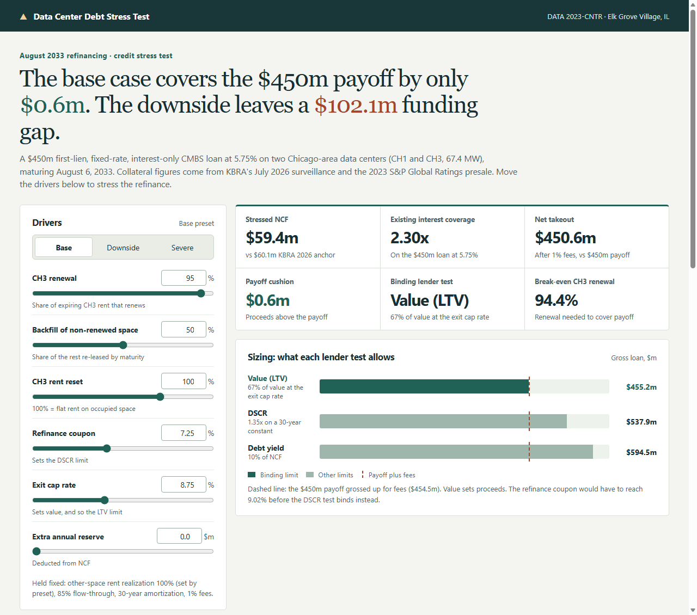
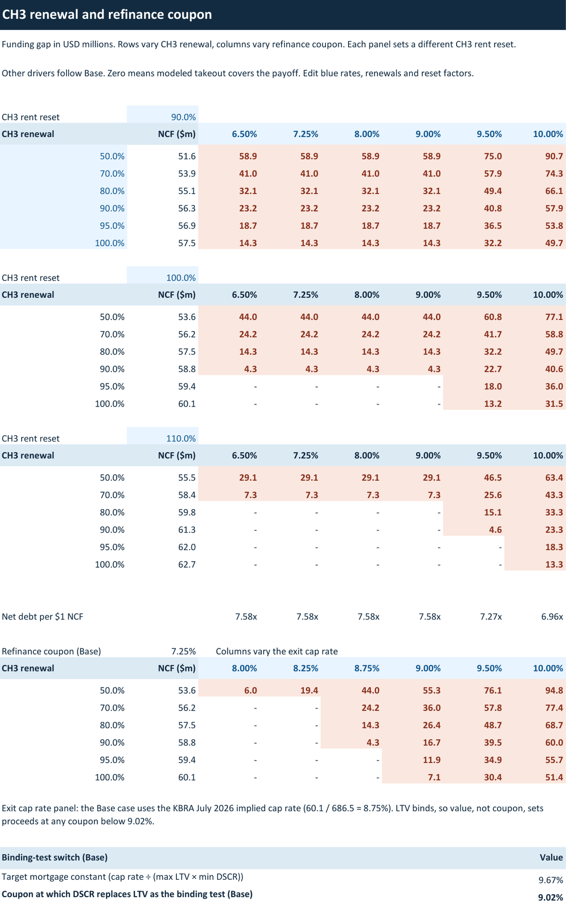

# Data Center Debt Stress Test

Can the $450 million DATA 2023-CNTR loan refinance when it matures in August 2033? The loan is a single-borrower CMBS mortgage on a two-building data center campus in Elk Grove Village, Illinois, owned by Digital Realty and GI Partners. This project models the refinancing from public disclosures, finds what breaks it, and names the diligence item that would change the answer most.

**Finding:** in the base case, the new loan covers the payoff by only **$0.6 million**, and only if KBRA's 2026 property value holds. Each 25 basis points of exit cap rate expansion opens a gap of about $12 million. In the downside case, cash flow still covers today's interest **1.93x**, but there is a **$102.1 million refinancing gap**: cash the owners would need to find beyond the modeled loan proceeds.

**[Open the live stress test](https://domcity2003.github.io/data-center-debt-stress-test/)** · [Two-page credit memo (PDF)](output/DATA_2023_CNTR_Credit_Memo.pdf) · [Excel model](output/Data_Center_Debt_Stress_Test.xlsx) · [Deal inputs](data/deal.json)



| Case | Existing interest coverage | Net proceeds | Payoff cushion | Funding gap | Break-even CH3 renewal |
| --- | ---: | ---: | ---: | ---: | ---: |
| Base | 2.30x | $450.6m | $0.6m | — | 94.4% |
| Downside | 1.93x | $347.9m | — | $102.1m | Not reachable |
| Severe | 1.54x | $252.0m | — | $198.0m | Not reachable |

## What breaks the refinancing

- **Value, more than the interest rate.** The base case takes KBRA's July 2026 value at face: $60.1m of cash flow at an implied 8.75% cap rate. The 67% loan-to-value test sets the new loan size, so the refinance rate does not matter until it passes **9.02%**. Above that, the debt service coverage test takes over. A 9.00% exit cap rate on its own creates an $11.9m gap.
- **CH3 renewals.** The 2023 presale shows 27 MW and $30.8m of annual base rent at CH3 (one of the two buildings) expiring in 2026–27. About 94.4% of that rent must renew at the same level for the base case to clear. In the downside and severe cases, even full renewal does not close the gap.
- **First diligence request:** the current CH3 rent roll and signed lease amendments, showing which suites pay contracted rent through August 2033. A five-year renewal signed in 2026 can come up again before the loan is repaid.

## Try it

- **Live stress test:** pick **Downside** to see the $102.1m gap. Then move the exit cap rate back toward 8.75% and watch which lender test sets the loan size. Both heatmaps (renewal against interest rate, and renewal against cap rate) update with the drivers.
- **Excel model:** edit the blue cells on **Assumptions** and follow the loan sizing on **Sizing**. The other tabs:
  - **Stress Grid** has three interest-rate panels at different CH3 rent levels, a cap-rate panel, and the interest rate at which the coverage test takes over.
  - **Sources** gives the date and location of each disclosure.



## How it works

1. Start from KBRA's July 2026 cash flow of $60.1m.
2. Apply the CH3 renewal, re-leasing and rent-reset assumptions to the 2026–27 rent from the presale. 85% of each rent change reaches cash flow. Subtract any extra reserve.
3. Size the new loan at the lowest of three lender limits:
   - 67% of value at the exit cap rate;
   - 1.35x debt service coverage on a 30-year amortizing loan;
   - a 10% debt yield (cash flow divided by loan amount).
4. Take off 1% fees and compare with the $450m balloon payment.

Every input is in [data/deal.json](data/deal.json). The same model is built three times, in Python ([model.py](model.py)), in the browser ([web/model.js](web/model.js)) and as Excel formulas, and the tests check that all three agree.

```powershell
python -m unittest -v
node --test
```

- `python -m unittest` runs 8 tests using only the standard library. They cover:
  - a base case checked by hand;
  - the break-even renewal, including cases where no renewal level is enough;
  - the interest rate at which the coverage test takes over;
  - that the gaps move in the right direction across both grids;
  - input validation.
- `node --test` checks that the browser model gives the same answer as `python model.py` for all 209 numbers.
- GitHub Actions runs both on every push.

To rebuild the outputs:

```powershell
uv run --with reportlab python build_memo.py
```

```powershell
uv run --with openpyxl python build_workbook.py
```

```powershell
node scripts/build_web_data.mjs
```

The first command rebuilds the memo PDF and the second the Excel workbook. Run the third after editing `deal.json`, so the browser version uses the new inputs. On Windows with Excel installed, the following command recalculates the workbook in Excel and checks 516 values against Python:

```powershell
uv run --with pywin32 --with pymupdf --with pillow python scripts/verify_workbook.py
```

## Sources and limits

| Source | Used for |
| --- | --- |
| [S&P Global Ratings presale, June 22, 2023](https://www.spglobal.com/_assets/documents/ratings/research/12758184.pdf) | Loan terms (5.75% fixed, interest-only, matures Aug 6, 2033), the 2026–27 lease expirations (Table 2), and value at issuance |
| [KBRA rating action, July 18, 2025](https://www.kbra.com/publications/mCZtPvZw/kbra-affirms-all-ratings-for-data-2023-cntr) | $48.2m KBRA net cash flow, $550.5m value |
| [KBRA rating action, July 17, 2026](https://www.kbra.com/publications/xMgkyWKv/kbra-upgrades-four-ratings-and-affirms-one-rating-for-data-2023-cntr) | $60.1m cash flow, $686.5m value, 65.5% loan-to-value, four upgrades |

- **Rent is a sensitivity, not a forecast.** The public sources can't match the 2026 cash flow to the 2023 rent roll lease by lease. Cash flow outside the stressed rent stays at the 2026 level.
- **Scope ends at loan payoff.** The model doesn't assign default probabilities or credit the owners' own cash. It also doesn't estimate losses on the CMBS bonds; see [AbsBox](https://github.com/yellowbean/AbsBox) for that kind of payment-waterfall analysis.
- This is independent research from public documents, not a rating or investment advice.

MIT license.
